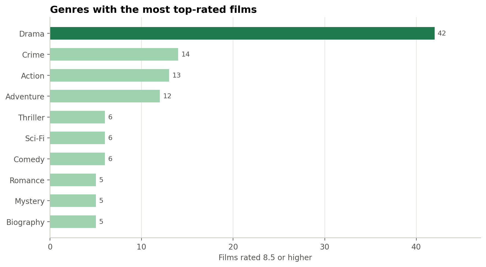
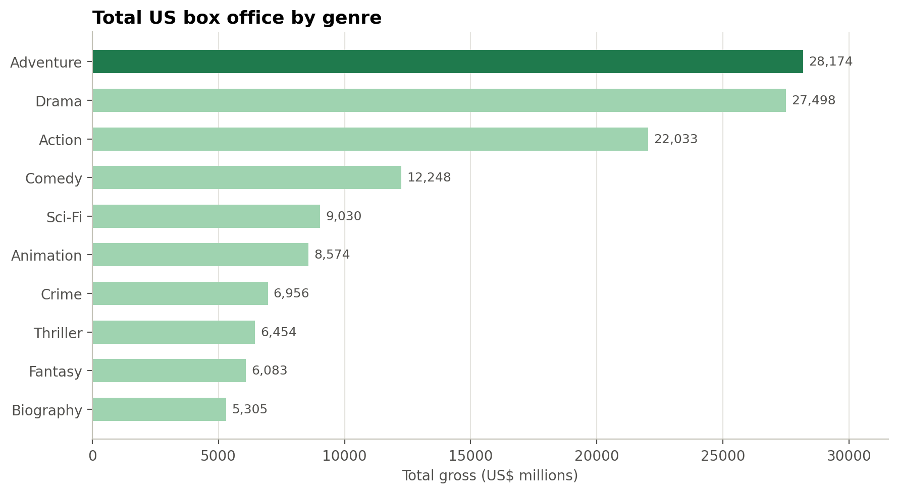
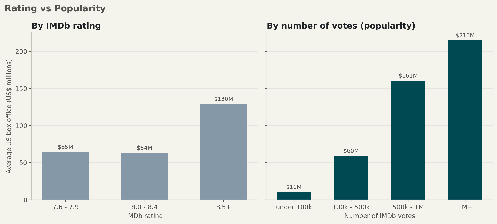
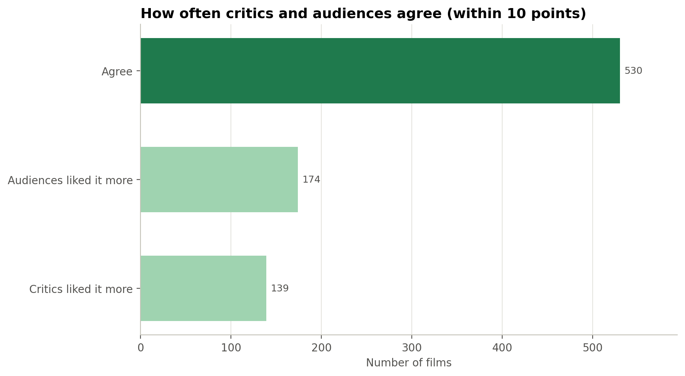
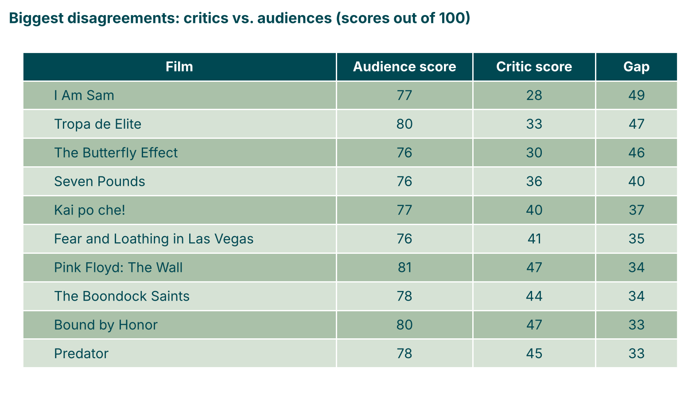
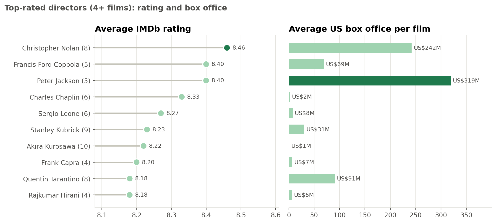
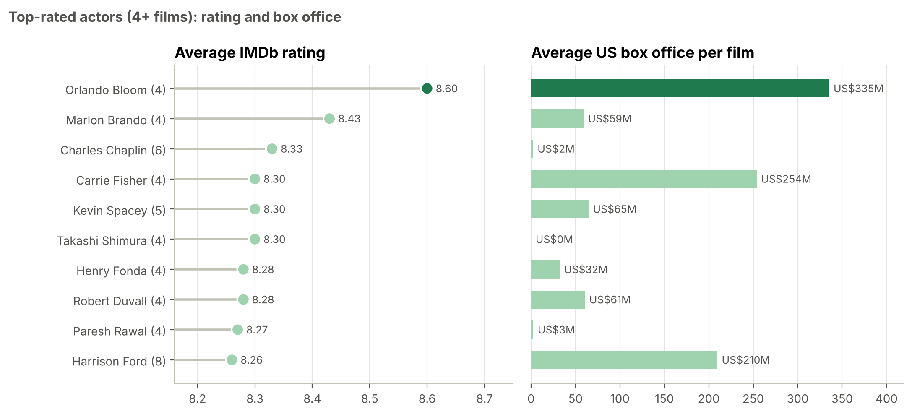
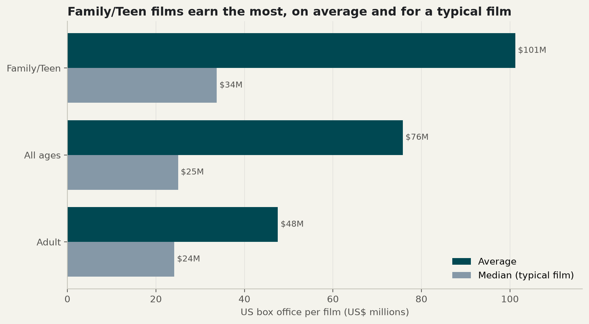

# Green Light Analytics: What Film Should We Greenlight Next?

## 1. Project Overview

Green Light Analytics helps film studios decide which movies to "greenlight", meaning approve for production. A small film studio planning a US cinema release asked us one question: **what kind of film should we make next to be both well rated and commercially successful?**

To answer it, we analysed the IMDb Top 1000 dataset: the 1000 highest-rated films on IMDb. We cleaned the data, designed and built a relational database, answered six business questions with SQL and Python, and turned the findings into recommendations for the studio.

**Main objectives**

- Understand which film characteristics (genre, popularity, talent, age certificate, release period) are linked to high ratings and high box office.
- Build a relational database that represents the film domain and supports these questions.
- Give the studio specific, data-based recommendations for its next production.

**Final Presentation:** [Green Light Analytics – Google Slides](https://docs.google.com/presentation/d/11WS1S31PitrTZD_l2pY1CgH6ms8a4EjiYjHz3lUr_MY/edit?usp=sharing)

## 2. Research Questions

1. **Genres:** Which genres produce the most top-rated films, and which earn the most at the box office?
2. **Rating vs. box office:** Does a high rating mean high box office, or does popularity (number of votes) matter more?
3. **Critics vs. audiences:** Do critics (Meta_score) and audiences (IMDb rating) agree on what makes a great film?
4. **Talent:** Which directors and actors consistently deliver highly rated and profitable films?
5. **Trends over time:** How has the mix of top films changed over the decades, and which genres are rising?
6. **Age certificate:** Does a film's age rating affect how much it earns?

## 3. Dataset Description

- **Source:** [IMDB Movies Dataset – Top 1000 Movies and TV Shows (Kaggle)](https://www.kaggle.com/datasets/harshitshankhdhar/imdb-dataset-of-top-1000-movies-and-tv-shows)
- **Licence:** `CC0: Public Domain](https://creativecommons.org/publicdomain/zero/1.0/) (as stated on the Kaggle dataset page)`
- **Size and structure:** one CSV file with 1,000 films and 16 columns
- **Main variables:**

| Variable | Meaning |
|---|---|
| `Series_Title` | Film title |
| `Released_Year` | Year of release |
| `Certificate` | Age certificate (Indian, US and TV rating systems) |
| `Runtime` | Duration in minutes |
| `Genre` | One to three genres per film |
| `IMDB_Rating` | Average audience rating (0–10) |
| `Meta_score` | Average critic score (0–100) |
| `Director` | Film director |
| `Star1` – `Star4` | Four main actors |
| `No_of_Votes` | Number of IMDb user votes (a measure of popularity) |
| `Gross` | US box office revenue in US dollars |

**Limitations**

- The dataset contains only the top 1000 rated films, so it shows what successful films have in common, not why films fail.
- Box office covers US cinema revenue only, not streaming or international revenue, is not adjusted for inflation, and does not include budgets, so profitability cannot be measured.
- 169 films have no box office data, so revenue analyses use the 831 films that do.
- The data ends in 2020, so the 2020s contain only 6 films.

### Main Data Quality Issues

- `Released_Year` stored as text, with one invalid value ("PG" for Apollo 13)
- `Runtime` stored as text with units ("142 min")
- `Gross` stored as text with commas ("28,341,469")
- Titles are not unique ("Drishyam" appears twice)
- Missing values: `Certificate` (101), `Meta_score` (157) and `Gross` (169)
- Certificates mix different rating systems (Indian, US and TV)
- `Genre` holds several values in one cell, and the four main actors are spread across four columns, which is not suitable for a relational database
- 4 films list the same actor twice in the star columns (directors who also act)

### Data Cleaning and Preparation

**Cleaning**

- Standardised column names to lowercase snake_case and renamed `series_title` → `movie_title`, `no_of_votes` → `number_of_votes` and `gross` → `gross_revenue`
- Removed `poster_link` and `overview`, as they are not needed for the analysis
- Corrected Apollo 13's release year to 1995 (verified on IMDb) and converted `released_year` to integer
- Removed " min" from `runtime` and the commas from `gross_revenue`, and converted both to integers
- Checked "Drishyam": two different films (2013 original and 2015 remake), both kept
- Added `movie_id` as a unique identifier, since titles are not unique
- Checked text columns for extra spaces and broken characters
- Labelled missing certificates as "Unrated" and grouped all certificates into four audience levels (All ages, Family/Teen, Adult, Unrated), so that the different rating systems can be compared
- Kept missing `meta_score` and `gross_revenue` values as missing (NULL) rather than estimating them, so that analyses only use real values

**Preparation for the database**

- Split the cleaned dataset into one CSV file per database table
- Split `genre` into one row per film and genre (`genres` and `movie_genres` tables)
- Turned the four star columns into one row per film and actor (`actors` and `movie_cast` tables), with `billing_order` keeping the original position; repeated actors in the same film were kept once, at their highest billing
- Checked every table for unique primary keys and for foreign keys without a matching parent row before loading

## 4. Methodology

**Tools:** Python (pandas, matplotlib) in JupyterLab, MySQL and MySQL Workbench, DrawDB for the ERD, Git and GitHub for collaboration.

**Workflow**

1. **Data cleaning (Python):** explored the raw CSV, fixed data types, inconsistencies and missing values, and saved a clean dataset.
2. **Database design:** identified the main entities and designed an Entity-Relationship model in DrawDB.
3. **Table preparation (Python):** split the clean dataset into the 8 table CSVs defined by the ERD and checked primary and foreign keys.
4. **Database implementation (SQL):** created the database and tables with primary and foreign keys, loaded the CSV files and compared the record counts with the prepared datasets.
5. **SQL analysis:** answered the research questions using filtering, sorting, aggregations, grouping, joins, subqueries and CTEs.
6. **Visualisation (Python):** ran the SQL queries from Python and turned the results into charts for the presentation.

### Database Design

The database has **8 tables**. Directors, certificates, genres and actors are each stored once, and films link to them through IDs.

| Table | Description | Primary key | Foreign keys |
|---|---|---|---|
| `movies` | One row per film: title, year, runtime, box office | `movie_id` | `director_id`, `certificate_id` |
| `directors` | One row per director | `director_id` | – |
| `certificates` | One row per age certificate, with its audience group | `certificate_id` | – |
| `ratings` | IMDb rating, Meta score and number of votes for each film | `rating_id` | `movie_id` |
| `genres` | One row per genre | `genre_id` | – |
| `movie_genres` | Links films and genres | `movie_genre_id` | `movie_id`, `genre_id` |
| `actors` | One row per actor | `actor_id` | – |
| `movie_cast` | Links films and actors, with billing order | `movie_cast_id` | `movie_id`, `actor_id` |

**Relationships:** one director → many films (1:N); one certificate → many films (1:N); one film → one set of ratings (1:1); films ↔ genres and films ↔ actors are many-to-many, through `movie_genres` and `movie_cast`.

**Design decisions**

- Genres and actors have their own tables because one film has several of each; keeping them in separate columns would repeat information and make queries harder.
- Ratings are kept in a separate table because they are audience and critic metrics that change over time, while the film's facts do not.
- In the link tables, the pairs (`movie_id`, `genre_id`) and (`movie_id`, `actor_id`) are unique, so the same genre or actor cannot appear twice in one film.


## 5. Key Findings

### 1. Genres

- **Drama produces by far the most top-rated films:** 42 films rated 8.5+, three times more than Crime (14).
- **Adventure, Sci-Fi and Action earn the most at the box office:** about US$166M, US$148M and US$141M per film on average (genres with at least 20 films), versus US$46M for Drama.





### 2. Rating vs. box office

- **Rating barely changes box office.** Films rated 8.0–8.4 earn the same as films rated 7.6–7.9 (about US$64M on average); only the 48 films rated 8.5+ earn more (US$130M).
- **Popularity makes a big difference.** Average box office rises with the number of votes, from US$11M (under 100k votes) to US$215M (1M+ votes).
- **The biggest earners are popular, not the best rated.** Of the 10 highest-earning films, only The Dark Knight is rated above 8.5, but 9 of the 10 have more than 500,000 votes.



### 3. Critics vs. audiences

- **Critics and audiences mostly agree.** Their average scores are almost the same (audiences 79.3, critics 78.0 out of 100), and they agree within 10 points on 530 of 843 films (63%). Only films with a critic score are included.
- **The biggest disagreements are rare.** For example, for I Am Sam audiences gave 77 and critics 28.





### 4. Talent

- **Christopher Nolan is the strongest director:** the highest average rating (8.46 over 8 films) and a high average box office (US$242M per film).
- **Peter Jackson** (8.40, US$319M) also combines quality and revenue, while many highly rated classic directors earn very little at the US box office.
- **Among actors, Orlando Bloom stands out for both rating and box office:** 8.60 and US$335M per film. Carrie Fisher (US$254M) and Harrison Ford (US$210M) also earn a lot.
- Only directors and actors with at least 4 films are included. The box office figures are the earnings of the films each person was part of, not their pay.





### 5. Trends over time

- **Most top films are recent:** the 2000s (237 films) and 2010s (242 films) account for almost half of the list.
- **Films grew to about 2 hours and stayed there:** average runtime rose from 86 minutes in the 1920s to about 2 hours by the 1950s–60s, and has stayed between 121 and 128 minutes since the 1960s.
- **Rising genres (1920–1999 → 2000–2020):** Action (14.2% → 23.9% of top films), Adventure (15.9% → 23.5%), Drama (69.3% → 75.7%), Biography and Animation.
- **Falling genres:** War (7.0% → 3.1%), Horror (4.7% → 1.6%) and Western (3.5% → 0.4%); Film-Noir has no films after 2000.


### 6. Age certificate

- **Family/Teen films earn the most:** US$101M per film on average, versus US$76M for All ages and US$48M for Adult.
- **They are also the most likely to be big hits:** 38% of Family/Teen films earn above the average box office, versus 24% of Adult films.
- **Adult films are the most common in the list (345 films) but earn the least**, so adult films can be top-rated, but bring in less revenue.



## 6. Conclusions

The data gives a clear profile of a film that is both well rated and commercially successful:

- **Genre:** Drama is the strongest genre for ratings, but Adventure, Sci-Fi and Action earn the most; Action and Adventure are also among the fastest-growing genres among recent top films.
- **Popularity:** reaching a large audience matters much more for box office than a very high rating.
- **Critics and audiences:** they mostly agree, so a film that pleases audiences is usually well received by critics too.
- **Talent:** a few directors, especially Christopher Nolan and Peter Jackson, consistently combine high ratings with high box office.
- **Age certificate:** a Family/Teen rating reaches the widest paying audience and earns the most.

**Recommendation**

Green Light Analytics recommends that the studio greenlight an **Adventure/Sci-Fi/Action film with a strong dramatic story**, aimed at a **Family/Teen rating (PG-13 or equivalent)** and a runtime of **about 2 hours**.

- **Invest in reach, not perfection.** A good rating (around 7.5+) is enough; marketing, franchise potential and broad appeal drive box office more than critical acclaim.
- **Choose the director according to the budget:**
  - **Big budget:** Christopher Nolan (8.46 average rating, US$242M average box office) or Peter Jackson (8.40, US$319M).
  - **Smaller budget:** directors since 2000 with top ratings but much smaller box office, such as Bong Joon Ho (8.17 over 3 films, US$18M) or Darren Aronofsky (8.07 over 3 films, US$46M).

These findings show relationships, not causes: popular films earn more, but successful films also attract more votes. They also come from films that are already top-rated, so they describe what the best films have in common.

## 7. Next Steps

- Add budget data to measure profitability, not only revenue.
- Adjust box office for inflation, so films from different decades can be compared fairly.
- Add international and streaming revenue for a fuller picture of commercial success.
- Compare the top 1000 with lower-rated films, to understand what makes films fail as well as succeed.

## 8. Repository Structure

The project follows this directory structure:

```text
├── data/
│   ├── raw/           # Original dataset
│   └── clean/         # Clean dataset and the 8 table CSVs
├── notebooks/         # Jupyter notebooks (cleaning, table preparation, charts)
├── sql_scripts/       # SQL scripts (create database, load data, queries)
├── figures/           # ERD, charts and visualizations
├── slides/            # Final presentation or link
├── config.yaml        # Project file paths
├── pyproject.toml     # Python dependencies
└── uv.lock            # Locked dependency versions
```

Each directory contains its own README with additional information about file organization and naming conventions.

### How to Run the Project

1. Clone the repository and install the dependencies:

```bash
git clone https://github.com/catarina-bm/first_project.git
cd first_project
uv sync
```

2. Activate the environment (`.\.venv\Scripts\activate` on Windows, `source .venv/bin/activate` on macOS/Linux) and start JupyterLab with `python -m jupyterlab`.
3. Run the cleaning notebook, then the table preparation notebook; they save the clean dataset and the 8 table CSVs in `data/clean/`.
4. In MySQL Workbench, run the database creation script in `sql_scripts/`, then the data loading script. Loading needs local files enabled (`SET GLOBAL local_infile = 1;` and `OPT_LOCAL_INFILE=1` in the connection's Advanced settings), and the file paths in the script must point to the folder where you cloned the project.
5. Run the query scripts in `sql_scripts/` to reproduce the SQL analysis.
6. Run the chart notebooks to reproduce the charts; they save the images in `figures/`.

## 9. Team Members

| Name | Role |
|---|---|
| Catarina Braga Macedo | Data Analyst |
| Bindu Valmiki | Data Analyst |
